<p align="center">
  
</p>

# botdesk

botdesk is a desktop workspace for persistent agent chats, local projects, files, terminals, and previews. It is built on [MonoCode](https://github.com/hardbeat920/monocode) and keeps its compact shell, panes, keyboard behavior, and design tokens.

On top of MonoCode, `main` adds a small botdesk layer:

- a narrow desk rail that groups local projects into named desks;
- an agent toolbar in each chat, so several providers (for example Hermes Agent, Codex, and Claude Code) can take turns in one conversation with an explicit context handoff;
- per-chat provider session continuity that survives restarts;
- lowercase `botdesk` app identity with a data directory separate from MonoCode.

This repository is a history-free snapshot. It contains no backend configuration, credentials, release signing material, or private infrastructure. The app runs locally and uses the provider CLIs already installed on your computer.

## Requirements

- Node.js 22 or later and npm
- Rust stable
- The platform dependencies required by [Tauri 2](https://v2.tauri.app/start/prerequisites/) (on Linux, see `scripts/install-linux-deps-*.sh`)

## Configure

No configuration is required to build or run this snapshot. `.env.example` documents the optional environment variables the app reads; copy it to `.env` only if you need to override one. Never commit a `.env` file.

## Develop and verify

```sh
npm ci
npm run lint
npm test
npx tsc --noEmit
npm run host:build
npm run build
npm run tauri -- dev
```

Rust checks:

```sh
cargo fmt --check --manifest-path src-tauri/Cargo.toml
cargo clippy --manifest-path src-tauri/Cargo.toml --workspace --all-targets -- -D warnings
cargo test --manifest-path src-tauri/Cargo.toml --workspace
```

## Security boundary

- Desks are local project groups, not access control.
- Provider sessions and project access stay on the user's machine. No account or remote connection is treated as authenticated merely because a CLI exists.
- Release signing, notarization, updater signing, and artifact credentials are intentionally absent. The updater is disabled. Pull-request CI is secretless and runs only on GitHub-hosted runners.

Please report vulnerabilities privately as described in [SECURITY.md](SECURITY.md).

## Project direction

See [ROADMAP.md](ROADMAP.md), [PRODUCT.md](PRODUCT.md), [DESIGN.md](DESIGN.md), and [docs/DESIGN-CHECKLIST.md](docs/DESIGN-CHECKLIST.md). Contributions follow [CONTRIBUTING.md](CONTRIBUTING.md) and [AGENTS.md](AGENTS.md).

## Attribution and license

botdesk is based on [MonoCode](https://github.com/hardbeat920/monocode). The inherited MonoCode source and botdesk contributions are available under the MIT License. Required copyright and trademark notices are preserved in [LICENSE](LICENSE) and [NOTICE](NOTICE).
